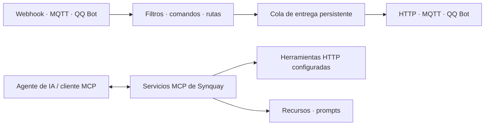

<p align="center">
  
</p>
<h1 align="center">Synquay</h1>
<p align="center">Conecta aplicaciones, mensajes y agentes de IA.</p>
<p align="center">
  <a href="https://github.com/letoille/synquay/actions/workflows/deb.yml"></a>
</p>

[English](README.md) · [简体中文](README.zh-CN.md) · [日本語](README.ja.md) · **Español**

Synquay es una pasarela autoalojada desarrollada con **Rust y React**. Conecta aplicaciones mediante Webhook, HTTP, MQTT y QQ Bot, dirige mensajes entre ellas y expone capacidades seleccionadas a agentes de IA a través de MCP.

[Documentación](#documentación) · [Versiones](https://github.com/letoille/synquay/releases) · [Issues](https://github.com/letoille/synquay/issues)

> **En desarrollo inicial.** Las API y la configuración pueden cambiar. La consola aún no tiene autenticación de inicio de sesión; úsala en una red privada o protégela con un proxy inverso autenticado.

## Casos de uso

- Reenviar eventos Webhook de una aplicación a un endpoint HTTP o un tema MQTT.
- Recibir mensajes de grupos o conversaciones privadas de QQ, reconocer comandos y responder o invocar una capacidad configurada.
- Publicar herramientas HTTP, recursos y prompts seleccionados para clientes MCP.
- Usar el modo independiente de bandeja de entrada del Agent para guardar mensajes, permitir que un worker reclame y procese tareas mediante MCP y enviar los resultados a un callback HTTP configurado.

Synquay se encarga de la integración y la entrega; la inferencia se ejecuta en tu Agent. Recibir un Webhook **no activa automáticamente ChatGPT ni otro cliente MCP**.

## Funciones

| Área | Disponible actualmente |
| --- | --- |
| Conexiones | Webhooks autenticados; clientes HTTP/HTTPS; suscripción y publicación MQTT 3.1.1 mediante TCP/TLS; mensajes de texto del QQ Bot oficial |
| Rutas | Filtros de origen, múltiples destinos, mapeo de comandos, respuestas directas, llamadas a capacidades y destinos Agent HTTP |
| MCP | Varios servicios con URL y ámbitos de exposición propios; Streamable HTTP; herramientas, recursos, plantillas de recursos, prompts y completado |
| Autenticación MCP | Basic Auth, validación JWT, introspección externa de tokens OAuth y modo sin autenticación; también se conserva la configuración Bearer del despliegue |
| Entrega | Persistencia SQLite, deduplicación de eventos, Outbox transaccional, colas limitadas, contrapresión y recuperación de resultados inciertos |
| Consola | Temas claro y oscuro; inglés, chino, japonés y español; listas de rutas y gráficos de relaciones |
| Operación | Logs estructurados, ID de petición, auditoría, copias de seguridad, paquetes Debian e integración con systemd |

Los recibos indican lo que puede confirmar el adaptador. No garantizan que un dispositivo haya ejecutado la acción ni que un sistema externo haya procesado el mensaje exactamente una vez.

## Cómo funciona



Las conexiones definen el protocolo y las credenciales. Las rutas deciden qué mensajes se procesan y a dónde se envían. Los servicios MCP determinan qué capacidades puede descubrir e invocar un Agent. Una conexión bidireccional puede ser origen y destino de una ruta.

## Primeros pasos

### Debian / Ubuntu

Descarga el paquete **amd64** y `SHA256SUMS` desde [Releases](https://github.com/letoille/synquay/releases) o desde el artefacto de una ejecución correcta del [workflow Debian package](https://github.com/letoille/synquay/actions/workflows/deb.yml). Si aún no hay un paquete publicado, ejecuta el workflow manualmente o compila desde el código fuente.

```bash
sha256sum --check SHA256SUMS
sudo apt install ./synquay_*.deb
systemctl status synquay
```

Abre **http://127.0.0.1:8080/** en la máquina donde lo instalaste. Para un servidor remoto:

```bash
ssh -L 8080:127.0.0.1:8080 user@server
```

El paquete incluye el backend, la consola y el servicio systemd. Se ejecuta con un usuario dedicado, genera credenciales propias en la primera instalación y conserva los datos y la configuración al actualizar. Consulta la [guía de empaquetado y despliegue](docs/debian.md) para compilar, usar otras arquitecturas o realizar copias de seguridad.

### Configura tu primer flujo

1. **Conexiones:** añade una conexión Webhook, MQTT, HTTP o QQ Bot.
2. **Rutas:** selecciona la conexión receptora, el procesamiento y el destino. Activa la conexión y la ruta cuando estén listas.
3. **Servicios MCP:** crea o edita un servicio, selecciona las capacidades que expondrá y configura su dirección y autenticación en tu cliente MCP.

El reenvío de mensajes funciona independientemente de MCP. La bandeja de entrada del Agent es un modo de despliegue separado; los resultados asíncronos todavía no se vinculan automáticamente con cualquier conversación de QQ para responder a ella.

### Desarrollo local

Necesitas Rust stable actual, **Node.js 22.18 o posterior de la rama 22.x** y Python 3.

```bash
git clone https://github.com/letoille/synquay.git
cd synquay
npm ci
```

Sigue la [guía de desarrollo local](docs/local-development.md) para inicializar una base de datos independiente y arrancar el backend y el frontend. Ejecutar el servidor sin configuración solo inicia el servicio HTTP básico.

```bash
npm run check
npm run test:frontend
npm run build:frontend
cargo build --release --locked -p synquay-server
```

## Documentación

La documentación detallada de diseño y protocolos está actualmente, en su mayoría, en chino.

| Guía | Contenido |
| --- | --- |
| [Desarrollo local](docs/local-development.md) | Configuración e inicio desde una copia nueva |
| [Despliegue Debian](docs/debian.md) | Paquetes, GitHub Actions, systemd, actualizaciones y copias de seguridad |
| [Conexiones de mensajes](docs/message-connections.md) | Configuración de MQTT, Webhook y HTTP |
| [QQ Bot](docs/qq-bot.md) | Callbacks, credenciales y restricciones de mensajería |
| [Rutas de conexión](docs/connection-routing.md) | Temas, conversaciones, comandos y respuestas |
| [Contenido MCP](docs/webhook-mcp.md) | Herramientas, recursos, prompts y límites del protocolo |
| [Bandeja de entrada del Agent](docs/agent-inbox.md) | Reclamar tareas y enviar resultados mediante MCP |
| [Arquitectura](docs/architecture/README.md) | Contratos de módulos y puntos de extensión |

## Estructura del proyecto

```text
backend/             Dominio Rust, servicios, adaptadores y API HTTP
frontend/            Consola de administración React
examples/            Ejemplos de protocolos e integración
scripts/             Herramientas de desarrollo, backup, verificación y empaquetado
docs/                Arquitectura y guías de operación
.github/workflows/   Workflow de compilación y publicación Debian
```

## Hoja de ruta

- Inicio de sesión en la consola y una experiencia completa de autorización.
- Puente hacia servidores MCP externos y adaptadores CLI ejecutables.
- Automatizaciones programadas y más conectores.
- Asociación fiable de respuestas asíncronas del Agent con la conversación de origen.

Son funciones previstas; el paquete actual todavía no las incluye.

## Contribuir

Usa [Issues](https://github.com/letoille/synquay/issues) para informar de errores o proponer mejoras. Consulta los cambios grandes antes de abrir un PR. Sigue las [convenciones de desarrollo](docs/development.md), ejecuta las comprobaciones anteriores e incluye los cambios de comportamiento y los resultados de validación en tu PR. Las mejoras de traducción y documentación son bienvenidas; mantén alineadas las versiones del README. No incluyas credenciales, mensajes privados ni bases de datos de ejecución en informes o commits.

## Licencia

La licencia aún no se ha elegido. El repositorio no concede actualmente una licencia de código abierto; no se deben asumir los términos de MIT o Apache-2.0.
