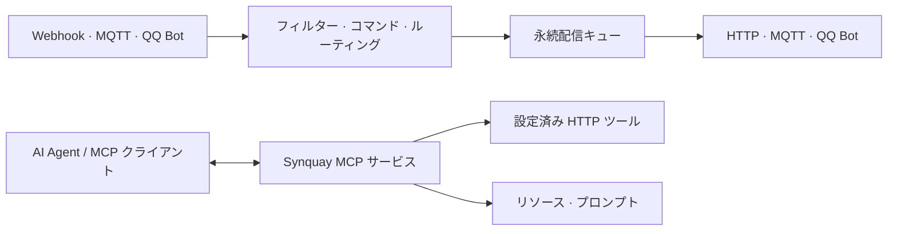

<p align="center">
  
</p>
<h1 align="center">Synquay</h1>
<p align="center">アプリケーション、メッセージ、AI エージェントをつなぐ。</p>
<p align="center">
  <a href="https://github.com/letoille/synquay/actions/workflows/deb.yml"></a>
</p>

[English](README.md) · [简体中文](README.zh-CN.md) · **日本語** · [Español](README.es.md)

Synquay は **Rust と React** で構築されたセルフホスト型ゲートウェイです。Webhook、HTTP、MQTT、QQ Bot でアプリケーションを接続し、メッセージをルーティングし、選択した機能を MCP 経由で AI エージェントに公開できます。

[ドキュメント](#ドキュメント) · [リリース](https://github.com/letoille/synquay/releases) · [Issues](https://github.com/letoille/synquay/issues)

> **開発初期段階です。** API や設定は変更される可能性があります。管理コンソールにはログイン認証がないため、プライベートネットワーク内で使用するか、認証付きリバースプロキシで保護してください。

## ユースケース

- アプリケーションの Webhook イベントを HTTP エンドポイントや MQTT トピックに転送する。
- QQ のグループ・個別メッセージを受信し、コマンドに応じて返信や設定済み機能の呼び出しを行う。
- 選択した HTTP ツール、リソース、プロンプトを MCP クライアントに公開する。

Synquay は接続と配信を担当し、モデル推論は Agent 側で実行します。Webhook の受信だけで **ChatGPT や他の MCP クライアントが自動的に起動することはありません**。

## 機能

| 分野 | 現在の対応範囲 |
| --- | --- |
| 接続 | 認証付き Webhook、HTTP/HTTPS クライアント、MQTT 3.1.1 の TCP/TLS 購読・配信、公式 QQ Bot のテキストメッセージ |
| ルーティング | 送信元フィルター、複数宛先、コマンド変換、直接返信、機能呼び出し |
| MCP | 個別 URL・公開範囲を持つ複数サービス、Streamable HTTP、ツール、リソース、リソーステンプレート、プロンプト、補完 |
| MCP 認証 | Basic Auth、JWT 検証、外部 OAuth トークンのイントロスペクション、認証なし。デプロイ単位の Bearer 設定も利用可能 |
| 配信 | SQLite 永続化、イベント重複排除、トランザクショナル Outbox、容量制限付きキュー、バックプレッシャー、不確定結果の復旧 |
| コンソール | ライト・ダークテーマ、英語・中国語・日本語・スペイン語、ルート一覧と関係図 |
| 運用 | 構造化ログ、リクエスト ID、監査記録、バックアップ、Debian パッケージ、systemd |

配信結果はアダプターが確認できる範囲を示します。デバイスでの実行完了や、外部システムでの厳密な一度だけの処理を保証するものではありません。

## 仕組み



接続はプロトコルと認証情報、ルートはメッセージの処理方法と宛先、MCP サービスは Agent に公開する機能を定義します。双方向接続はルートの入力にも出力にも利用できます。

## クイックスタート

### Debian / Ubuntu

[リリース](https://github.com/letoille/synquay/releases)、または成功した [Debian package ワークフロー](https://github.com/letoille/synquay/actions/workflows/deb.yml)の成果物から **amd64** パッケージと `SHA256SUMS` を取得します。未公開の場合はワークフローを手動実行するか、ソースからビルドしてください。

```bash
sha256sum --check SHA256SUMS
sudo apt install ./synquay_*.deb
systemctl status synquay
```

インストールしたマシンで **http://127.0.0.1:8080/** を開きます。リモートサーバーには SSH 転送で接続できます。

```bash
ssh -L 8080:127.0.0.1:8080 user@server
```

パッケージにはバックエンド、コンソール、systemd サービスが含まれます。専用ユーザーで実行し、初回インストール時に個別の認証情報を生成します。更新時には設定とデータを保持します。他のアーキテクチャ、ビルド、バックアップは[デプロイガイド](docs/debian.md)を参照してください。

### 最初のフローを設定する

1. **接続：** Webhook、MQTT、HTTP、QQ Bot のいずれかを追加します。
2. **ルート：** 受信接続、処理方法、宛先を選び、準備ができたら接続とルートを有効にします。
3. **MCP サービス：** サービスを作成・編集し、公開する機能を選択します。アドレスと認証情報を MCP クライアントに設定します。

メッセージ転送は MCP と独立して動作します。外部処理の結果を元の QQ 会話に自動的に関連付ける機能は未対応です。

### ローカル開発

現行の Rust stable、**Node.js 22.18 以降の 22.x**、Python 3 が必要です。

```bash
git clone https://github.com/letoille/synquay.git
cd synquay
npm ci
```

[ローカル開発ガイド](docs/local-development.md)に従って専用データベースと設定を用意し、バックエンドとフロントエンドを起動します。設定なしでサーバーを起動した場合は、基本 HTTP サービスのみが動作します。

```bash
npm run check
npm run test:frontend
npm run build:frontend
cargo build --release --locked -p synquay-server
```

## ドキュメント

詳細な設計・プロトコル文書は現在、主に中国語です。

| ガイド | 内容 |
| --- | --- |
| [ローカル開発](docs/local-development.md) | 新規チェックアウトからの設定と起動 |
| [Debian デプロイ](docs/debian.md) | パッケージ、GitHub Actions、systemd、更新、バックアップ |
| [メッセージ接続](docs/message-connections.md) | MQTT、Webhook、HTTP の設定 |
| [QQ Bot](docs/qq-bot.md) | コールバック、認証情報、メッセージの制約 |
| [接続ルーティング](docs/connection-routing.md) | トピック、会話、コマンド、返信 |
| [MCP コンテンツ](docs/webhook-mcp.md) | ツール、リソース、プロンプト、対応範囲 |
| [アーキテクチャ](docs/architecture/README.md) | モジュール契約と拡張ポイント |

## ディレクトリ構成

```text
backend/             Rust のドメイン、アプリケーション、アダプター、HTTP API
frontend/            React 管理コンソール
examples/            プロトコル・連携のサンプル
scripts/             開発、バックアップ、検証、パッケージツール
docs/                アーキテクチャと運用ガイド
.github/workflows/   Debian ビルド・リリースワークフロー
```

## ロードマップ

- 管理コンソールのログインと包括的な認可 UI。
- 上流 MCP サーバーのブリッジと実行可能な CLI アダプター。
- スケジュール実行と対応コネクターの拡充。

これらは計画中の機能であり、現在のパッケージには含まれていません。

## コントリビューション

不具合や提案は [Issues](https://github.com/letoille/synquay/issues) にお寄せください。大きな変更は PR の前に相談してください。[開発規約](docs/development.md)に従い、上記のチェックを実行し、PR に動作の変更と検証結果を記載してください。翻訳や文書の改善も歓迎します。各言語の README の内容を揃え、認証情報、個人のメッセージ、実行時データベースを投稿・コミットしないでください。

## ライセンス

ライセンスは未決定です。現時点でオープンソースライセンスは付与されておらず、MIT や Apache-2.0 が適用されるとは限りません。
