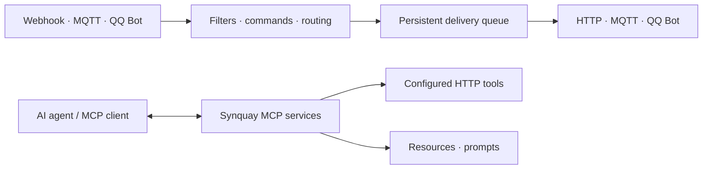

<p align="center">
  
</p>
<h1 align="center">Synquay</h1>
<p align="center">Connect applications, messages, and AI agents.</p>
<p align="center">
  <a href="https://github.com/letoille/synquay/actions/workflows/deb.yml"></a>
</p>

**English** · [简体中文](README.zh-CN.md) · [日本語](README.ja.md) · [Español](README.es.md)

Synquay is a self-hosted gateway built with **Rust and React**. Connect applications through Webhook, HTTP, MQTT, and QQ Bot; route messages between them; and expose selected capabilities to AI agents through MCP.

[Documentation](#documentation) · [Releases](https://github.com/letoille/synquay/releases) · [Issues](https://github.com/letoille/synquay/issues)

> **Early development.** APIs and configuration may change. The management console does not yet have login authentication; keep it on a private network or protect it with an authenticated reverse proxy.

## What you can build

- Forward an application's Webhook events to an HTTP endpoint or MQTT topic.
- Receive QQ group or direct messages, match commands, and reply or invoke a configured capability.
- Give an MCP client access to selected HTTP tools, resources, and prompts.

Synquay handles integration and delivery. Model inference runs in your Agent. Receiving a Webhook does **not** automatically wake ChatGPT or another MCP client.

## Features

| Area | Available today |
| --- | --- |
| Connections | Authenticated Webhooks; HTTP/HTTPS clients; MQTT 3.1.1 subscriptions and publishing over TCP/TLS; official QQ Bot text messaging |
| Routing | Source filters, multiple destinations, command mapping, direct replies, capability calls |
| MCP | Multiple services with separate URLs and exposure scopes; Streamable HTTP; tools, resources, resource templates, prompts, and completion |
| MCP authentication | Basic Auth, JWT verification, external OAuth token introspection, and unauthenticated mode; deployment-level Bearer configuration remains available |
| Delivery | SQLite persistence, event deduplication, transactional Outbox, bounded queues, backpressure, and recovery for uncertain outcomes |
| Console | Light/dark themes; English, Chinese, Japanese, and Spanish; route lists and relationship graphs |
| Operations | Structured logs, request IDs, audit records, backup tooling, Debian packages, and systemd integration |

Delivery receipts describe what the adapter can confirm; they do not guarantee that a device acted on a message or that a third party processed it exactly once.

## How it fits together



Connections define protocol settings and credentials. Routes define which messages go where and how to process them. MCP services define what an Agent can discover and call. A bidirectional connection can be used on either side of a route.

## Get started

### Debian / Ubuntu

Download an **amd64** package and `SHA256SUMS` from [Releases](https://github.com/letoille/synquay/releases), or the artifact of a successful [Debian package workflow](https://github.com/letoille/synquay/actions/workflows/deb.yml). If no package has been published yet, run the workflow manually or build from source.

```bash
sha256sum --check SHA256SUMS
sudo apt install ./synquay_*.deb
systemctl status synquay
```

Open **http://127.0.0.1:8080/** on the installed machine. For a remote server:

```bash
ssh -L 8080:127.0.0.1:8080 user@server
```

The package includes the backend, console, and systemd service. It runs as a dedicated user, creates installation-specific credentials, and preserves configuration and data during upgrades. See [packaging and deployment](docs/debian.md) for build commands, other architectures, and backup instructions.

### Configure your first flow

1. **Connections:** add a Webhook, MQTT, HTTP, or QQ Bot connection.
2. **Routes:** choose a receiving connection, processing mode, and destination. Enable the connection and route when ready.
3. **MCP services:** create or edit a service and select the capabilities to expose. Add its address and authentication settings to your MCP client.

Message forwarding can run independently of MCP. External processors may use configured connections; asynchronous replies are not automatically linked to arbitrary QQ conversations.

### Develop locally

Use current Rust stable, **Node.js 22.18+** on the 22.x line, and Python 3.

```bash
git clone https://github.com/letoille/synquay.git
cd synquay
npm ci
```

Follow the [local development guide](docs/local-development.md) to initialize a private development database and start the backend and frontend. Running the bare server without configuration only starts the base HTTP service.

```bash
npm run check
npm run test:frontend
npm run build:frontend
cargo build --release --locked -p synquay-server
```

## Documentation

Most detailed design and protocol documents are currently in Chinese.

| Guide | Contents |
| --- | --- |
| [Local development](docs/local-development.md) | Fresh checkout, configuration, and startup |
| [Debian deployment](docs/debian.md) | Packaging, GitHub Actions, systemd, upgrades, and backups |
| [Message connections](docs/message-connections.md) | MQTT, Webhook, and HTTP settings |
| [QQ Bot](docs/qq-bot.md) | Callbacks, credentials, and messaging constraints |
| [Connection routing](docs/connection-routing.md) | Topics, conversations, commands, and replies |
| [MCP content](docs/webhook-mcp.md) | Tools, resources, prompts, and protocol boundaries |
| [Architecture](docs/architecture/README.md) | Module contracts and extension points |

## Project layout

```text
backend/             Rust domain, application services, adapters, and HTTP API
frontend/            React management console
examples/            Protocol and integration examples
scripts/             Development, backup, verification, and packaging tools
docs/                Architecture and operating guides
.github/workflows/   Debian build and release workflow
```

## Roadmap

- Management-console login and a complete authorization experience.
- Upstream MCP server bridging and executable CLI adapters.
- Scheduled automation and broader connector support.

These are planned capabilities, not features enabled by the current package.

## Contributing

Use [Issues](https://github.com/letoille/synquay/issues) for bugs and proposals. Discuss larger changes before opening a pull request. Follow the [development conventions](docs/development.md), run the checks above, and include the behavior change and validation results in your PR. Improvements to translations and documentation are welcome; keep all README versions aligned. Never include credentials, private messages, or runtime databases in reports or commits.

## License

A license has not yet been selected. The repository does not currently grant an open-source license; do not assume MIT or Apache-2.0 terms apply.
