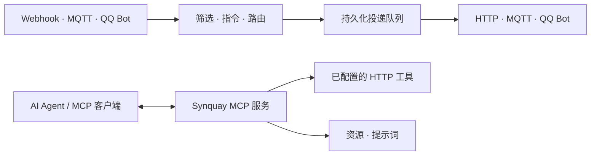

<p align="center">
  
</p>
<h1 align="center">Synquay</h1>
<p align="center">连接应用、消息与 AI Agent。</p>
<p align="center">
  <a href="https://github.com/letoille/synquay/actions/workflows/deb.yml"></a>
</p>

[English](README.md) · **简体中文** · [日本語](README.ja.md) · [Español](README.es.md)

Synquay（汇流港）是使用 **Rust 和 React** 构建的自托管网关。通过 Webhook、HTTP、MQTT 和 QQ Bot 接入应用，在连接之间路由消息，并通过 MCP 向 AI Agent 开放选定的能力。

[文档](#文档) · [版本发布](https://github.com/letoille/synquay/releases) · [问题反馈](https://github.com/letoille/synquay/issues)

> **早期开发阶段。** API 和配置可能变化。管理台尚无登录鉴权，请在内网使用，或通过带认证的反向代理保护。

## 可以用来做什么

- 将应用的 Webhook 事件转发到 HTTP 接口或 MQTT Topic。
- 接收 QQ 群聊、单聊消息，匹配指令后回复或调用已配置的能力。
- 向 MCP 客户端开放选定的 HTTP 工具、资源和提示词。
- 使用独立的 Agent 收件箱模式持久化消息，由 Agent Worker 通过 MCP 领取和处理任务，再将结果投递到配置的 HTTP 回调。

Synquay 负责接入与投递，模型推理由 Agent 完成。收到 Webhook **不会自动唤醒 ChatGPT 或其他 MCP 客户端**。

## 功能

| 模块 | 当前支持 |
| --- | --- |
| 连接 | 带认证的 Webhook；HTTP/HTTPS 客户端；MQTT 3.1.1 TCP/TLS 订阅与发布；QQ 官方机器人文本消息 |
| 路由 | 来源筛选、多目标转发、指令映射、直接回复、能力调用、HTTP Agent 目标 |
| MCP | 多服务、独立地址与开放范围；Streamable HTTP；工具、资源、资源模板、提示词和参数补全 |
| MCP 认证 | Basic Auth、JWT 校验、外部 OAuth 令牌内省、无认证；保留部署级 Bearer 配置 |
| 投递 | SQLite 持久化、事件去重、事务 Outbox、有界队列、背压与不确定结果恢复 |
| 管理台 | 明暗主题；中、英、日、西四种语言；路由列表与关系图 |
| 运维 | 结构化日志、请求 ID、审计记录、备份工具、deb 安装包与 systemd |

投递回执只表示适配器可以确认的结果，不代表设备已执行指令，也不保证第三方恰好处理一次。

## 工作方式



连接管理协议和凭据；路由决定哪些消息发往哪里、如何处理；MCP 服务决定 Agent 可以发现和调用哪些能力。双向连接可以同时作为路由的来源和目标。

## 快速开始

### Debian / Ubuntu

从 [Releases](https://github.com/letoille/synquay/releases) 或成功的 [Debian package 工作流](https://github.com/letoille/synquay/actions/workflows/deb.yml)下载 **amd64** 安装包与 `SHA256SUMS`。如果尚未发布安装包，可手动运行工作流或从源码构建。

```bash
sha256sum --check SHA256SUMS
sudo apt install ./synquay_*.deb
systemctl status synquay
```

在安装机器上打开 **http://127.0.0.1:8080/**。远程服务器可使用 SSH 转发：

```bash
ssh -L 8080:127.0.0.1:8080 user@server
```

安装包包含后端、管理台与 systemd 服务，使用独立用户运行，首次安装生成独立凭据，升级保留配置和数据。构建、其他架构及备份方式见 [打包与部署](docs/debian.md)。

### 配置第一条消息链路

1. **连接**：添加 Webhook、MQTT、HTTP 或 QQ Bot 连接。
2. **路由**：选择接收连接、处理方式和发送目标，准备好后启用连接与路由。
3. **MCP 服务**：创建或编辑服务，选择开放能力，将地址和认证信息配置到 MCP 客户端。

消息转发可以独立于 MCP 运行。Agent 收件箱属于独立部署模式；异步 Agent 结果尚不能自动关联并回复任意 QQ 原会话。

### 本地开发

需要当前 Rust stable、**Node.js 22.18+（22.x）** 和 Python 3。

```bash
git clone https://github.com/letoille/synquay.git
cd synquay
npm ci
```

按照 [本地开发指南](docs/local-development.md) 初始化独立开发数据库，再启动前后端。不带配置直接运行后端只会启动基础 HTTP 服务。

```bash
npm run check
npm run test:frontend
npm run build:frontend
cargo build --release --locked -p synquay-server
```

## 文档

详细设计与协议文档目前主要使用中文。

| 指南 | 内容 |
| --- | --- |
| [本地开发](docs/local-development.md) | 从全新仓库初始化配置、启动服务 |
| [deb 部署](docs/debian.md) | 打包、GitHub Actions、systemd、升级与备份 |
| [消息连接](docs/message-connections.md) | MQTT、Webhook、HTTP 配置 |
| [QQ Bot](docs/qq-bot.md) | 回调、密钥与消息收发约束 |
| [连接路由](docs/connection-routing.md) | Topic、会话、指令与回复 |
| [MCP 内容](docs/webhook-mcp.md) | 工具、资源、提示词及协议边界 |
| [Agent 收件箱](docs/agent-inbox.md) | 通过 MCP 领取任务和提交结果 |
| [架构](docs/architecture/README.md) | 模块契约与扩展点 |

## 项目结构

```text
backend/             Rust 领域层、应用服务、适配器与 HTTP API
frontend/            React 管理台
examples/            协议与集成示例
scripts/             开发、备份、验证与打包工具
docs/                架构与运行指南
.github/workflows/   Debian 构建与发布工作流
```

## 路线图

- 管理台登录与完整的授权交互。
- 上游 MCP Server 桥接与可执行 CLI 适配器。
- 定时自动化与更多连接器。
- 异步 Agent 结果与来源会话的可信回复关联。

以上为规划能力，当前安装包尚未提供。

## 参与贡献

通过 [Issues](https://github.com/letoille/synquay/issues) 提交问题和建议，较大的改动请先讨论。遵循 [开发约定](docs/development.md)，运行上述检查，并在 PR 中说明行为变化和验证结果。欢迎改进翻译与文档，请同步各语言 README。报告和提交中不要包含凭据、私人消息或运行数据库。

## 许可证

许可证尚未确定。目前仓库未授予开源许可，请勿默认适用 MIT 或 Apache-2.0。
