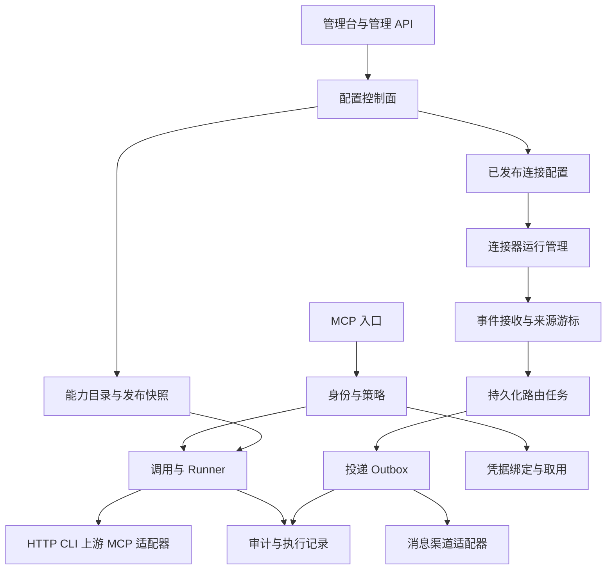

# Synquay 核心架构与模块契约

资料空间：[核心架构与模块契约](https://chatgpt.com/space/page_2d733ab38e988191abd8a7cc04ea91a2)。页面映射保存在 [space-pages.json](space-pages.json)。

> **方向更新（2026-10-28）**：本页是历史设计基线；产品范围和 Agent 相关模块的后续方向以[架构收敛方案](scope-convergence.md)为准。已实现功能仍以代码及运行文档为准。

架构设计基线 v0.4，2026-10-24。Synquay 将应用能力、事件来源和消息渠道接入 Agent；采用 Rust 模块化单体、React 管理台，先以单工作区部署，所有数据和授权边界显式携带 workspace_id。模块是职责边界，当前不要求每个模块成为独立 crate 或服务。

这组设计确定模块职责、领域对象、端口、状态机、事务边界、失败恢复和验收条件。除明确标注的现有能力外，新增 trait 和实体均为待实现设计，不是已经提供的 API。Rust 片段是契约草案，省略领域类型定义；它们不作为当前编译通过的接口声明。

## 当前实现与目标

已实现：分层与连接器端口、工具/回复应用服务、SQLite EventStore/Outbox/AuditLog、静态多目标 HTTP 转发、容量与磁盘保护。P0 已补受保护的核查/放弃/重放、投递尝试账本、目标隔离/限速/熔断、指标与负载脚本；P1 已补流式内容、公平数据库调度、保留清理/备份恢复及来源/版本契约；数据库为 v8，114 项回归测试通过，空间模块新增成员与状态授权；另有 1 项默认忽略的编码微基准。

已实现受信任文件配置 HTTP 工具、MCP 认证调用及结果审计闭环，并支持外部 OAuth 令牌校验和工具暴露范围在线发布。Keycloak 本地真实授权联调已通过。公网客户端验证和动态 grant 管理仍待实现。配置管理、后台执行和协议入口共享应用服务及授权规则。

## 模块目录

| 模块 | 独立职责 | 当前状态 |
|---|---|---|
| [01 配置控制面](modules/01-control-plane.md) | 连接与路由配置、版本、发布和激活 | 文件与在线暴露发布、双重 CAS、快照恢复已实现 |
| [02 能力目录与发布](modules/02-capabilities.md) | 发现目录、Schema、Profile 暴露范围 | 统一能力/协议绑定抽象、HTTP 对接、Profile 与暴露范围已实现 |
| [03 身份权限与审批](modules/03-identity-policy.md) | 认证、授权、委托、撤销与条件审批 | 静态 Bearer、OAuth introspection 与工具白名单已实现 |
| [04 凭据管理](modules/04-credentials.md) | 凭据绑定、取用、刷新与轮换 | 环境变量取用已实现；凭据仓储待实现 |
| [05 连接器运行管理](modules/05-connector-runtime.md) | 创建实例、监督运行、重连和节点管理 | 能力注册表与生命周期 trait 已有 |
| [06 事件与来源订阅](modules/06-events-sources.md) | 可靠接收、来源游标、内容版本 | 接收、原子检查点及实例隔离已实现 |
| [07 路由与处理计划](modules/07-routing.md) | 过滤、转换、扇出、分析分支 | 单条静态规则和原子投递计划已实现 |
| [08 投递与恢复](modules/08-delivery.md) | Outbox、尝试、核查与人工重放 | 租约、尝试、受保护恢复及目标调度已实现 |
| [09 工具调用与 Runner](modules/09-invocations-runners.md) | 调用账本、长任务、进程执行 | HTTP 执行与持久化调用账本已实现；CLI Runner 待实现 |
| [11 会话回复与附件](modules/11-conversations-content.md) | 消息映射、返回路线、受保护内容 | 回复服务及本地流式内容存储已实现 |
| [12 MCP 协议与桥接](modules/12-mcp.md) | 下游服务、上游客户端、兼容转换 | tools 服务及 SDK 互通已实现；上游桥接待实现 |
| [13 审计与可观测性](modules/13-audit-observability.md) | 审计查询、关联、指标与健康 | SQLite 审计、tracing、运行指标已实现 |
| [14 存储与运行运维](modules/14-storage-operations.md) | 迁移、事务实现、容量、备份恢复 | SQLite v8、空间成员索引、维护、备份恢复与索引已实现 |
| [15 管理接口与 SDK](modules/15-management-sdk.md) | 管理交互、契约生成、导入导出 | 首期管理台、浏览器来源校验、发布核查与历史已实现 |

模块之间的精确写入顺序、授权继承和幂等约束见 [跨模块对接契约](contracts.md)。迁移与实施顺序见 [实施路线与验收](roadmap.md)。

各模块的并发边界、数据所有权与测量方法见 [并发与内存设计](performance.md)。

积压限额、磁盘水位、失败路由隔离及 SQLite v2 迁移见 [积压容量与异常恢复](backpressure.md)。

当前 P0 实现、管理接口和容量基线见 [P0 调度、恢复与容量基线](p0-operations.md)。

P1 实现与启用方式见 [内容存储、数据库调度与运行契约](p1-storage.md)。

MCP 工具调用见 [MCP 工具发布与调用闭环](mcp-tools.md)。最新认证和管理 API 见 [OAuth 接入与在线配置发布](oauth-publication.md)。

真实授权服务的运行方式与结果见 [Keycloak 本地授权联调](keycloak-integration.md)。

管理台的信息架构、关键流程、视觉规范与分期范围见 [管理台设计](management-console.md)。整体设计分期实施，首期实现与验收见[管理台运行说明](../management-console.md)。

## 总体依赖

箭头表示主要调用或数据流，不表示领域模型必须互相依赖。仓储和网络端口定义在 application；基础设施实现这些端口；协议层负责 DTO 转换。后台任务是受授权的执行者，不能因为运行在服务器上就获得所有租户和资源权限。

## 统一决策

1. 连接器定义与连接实例分开。定义描述配置 Schema 和能力；实例绑定租户、运行节点、配置版本和凭据引用。原生 Rust 插件暂编译进程序，其他语言 SDK 用版本化进程协议接入，不承诺动态 Rust ABI。
2. 配置版本不可变，任务固定配置和能力版本；当前授权与撤销状态在每次取用秘密及产生副作用前重新检查。回滚生成新的发布记录，不重写历史。
3. 接收、路由、投递和工具调用分别维护状态。可共用租约和时钟类型，不共用一个语义模糊的万能 Job 表。
4. 自动重试复用逻辑 ID、内容和目标；人工重放创建新的 run_id，保留 event_id、父执行、配置版本和原因。结果未知必须先核查，不能把重放当作无重复风险的操作。
5. MCP tools/resources/prompts 与业务事件采用独立能力端口。特定客户端能否后台触发以版本化兼容测试为准，协议通知不被当作通用唤醒能力。
6. 权限范围取主体、客户端、Profile、资源、凭据绑定及委托任务范围的交集。默认拒绝；策略明确要求时才创建审批，不给所有正常转发增加人工确认。
7. SQLite 继续作为首版存储，沿用已验证的 rusqlite 实现；需要 PostgreSQL 时增加端口实现。数据库访问有界排队，外部 I/O 不在事务中等待。
8. 初版不实现完整推理平台或通用工作流编辑器；AI 处理由外部 Agent 执行。路由只包含受限筛选、字段投影、转换和显式分支。

## 文档与代码的关系

本目录是 v0.4 目标设计；`docs/module-integration.md` 和 `docs/http-relay.md` 描述当前可执行行为。发现不一致时先核对代码和迁移计划，不能仅因目标文档包含某个端口就对外宣称已支持。落实模块时同时更新其“当前状态”和验收记录。

统一能力模型、资源和协议绑定的当前实现与边界见 [统一能力层](capability-layer.md)。

空间领域模型、角色权限及管理 API 见 [空间模型与授权](workspaces.md)。当前接入 MCP 工具运行时；独立消息管线的空间成员鉴权待统一接入。
