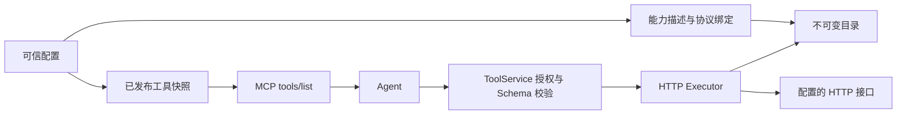

# 统一能力层：描述、资源与协议绑定

2026-10-24。本文对应当前代码，不代表 MQTT、CLI 或定时任务已经可以执行。

## 已实现范围

- `domain/capability` 提供动作、状态、事件的带类型描述，以及资源引用、来源、不可变版本和完成条件。
- `ProtocolBinding` 提供 HTTP JSON POST、CLI argv、MQTT 发布/订阅、上游 MCP 工具的独立配置契约和组合校验。执行配置不进入公开能力描述。
- `CapabilityCatalog`、`ResourceCatalog`、`StateReader` 是内部应用端口。已有不可变内存目录实现；状态读取端口尚无驱动实现。
- 现有 HTTP 配置经兼容转换生成能力及绑定。HTTP Executor 从目录读取精确版本的绑定执行；原有认证、Schema 校验、调用账本、发布控制保持生效。
- `ToolDefinition.documentation` 可选，支持使用条件、前置条件、调用示例和错误恢复说明。MCP tools/list 将它们投影为工具描述；HTTP 启动前校验示例符合输入 Schema。参数含义、单位和枚举仍在 JSON Schema 中描述。

## 类型与职责

| 类型 | 职责 |
|---|---|
| CapabilityRef | 工作区、连接、稳定能力 ID 和能力版本 |
| CapabilityDescriptor | 能力来源、可选业务资源引用和 Action/State/Event 描述 |
| ExecutionSemantics | Inline/Deferred、完成条件、幂等性声明、执行时限 |
| ResourceDefinition / ResourceRef | 业务对象的类型、名称、说明及精确版本；区别于 MCP resource URI |
| BoundCapability | 将能力版本与协议绑定版本固定在一个不可变快照中 |
| ValueBinding / PayloadMapping | 固定 JSON 字段从字面量、参数 JSON Pointer 或调用编号取值 |
| StateObservation | 原始状态、来源时间、接收时间及 Live/Retained/Historical 来源 |

`CapabilitySpec::Action` 才能投影为 ToolDefinition。订阅状态或事件不会自动变成一个可调用动作。公开描述不包含绑定的 URL、程序路径或 MQTT topic；目录端口中的 binding() 只用于内部执行，不是对外发现 API。

绑定版本独立记录，但同一 CapabilityRef 只能对应一份绑定；改变绑定必须发布新能力版本，不能替换既有目录条目。Profile 版本控制公开集合，能力和绑定版本控制执行契约，不能混为一个最新版本指针。当前 HTTP 兼容转换用文件 revision 初始化能力和绑定版本；在线暴露发布不会更换运行中的 HTTP 绑定。

## 数据流

尚未实现的下一条路径是：工具调用 → 确定执行计划 → 原子保存 Invocation 与投递意图 → Outbox → MQTT 发布 → 关联回执。不能用当前绑定结构宣称已经完成这条链路。

## 校验和权限边界

1. 目录拒绝重复版本、无效绑定、缺失资源及跨工作区/连接资源引用。精确版本查找失败不会回退到最新版本。条目返回 Arc，重复读取不复制 Schema 或描述。
2. 目录是内部端口，OperationContext 不等于授权；它只验证连接范围、取消和截止时间。外部入口仍必须先经过策略、Profile 和资源权限检查。当前仅已有 HTTP 工具授权；动态业务资源授权与公开资源发现还未实现。
3. Imported/Discovered 只是来源标记，不代表已审核或自动暴露。以后自动导入必须先形成草稿，由既有发布机制决定可见性。能力说明是数据，不能覆盖系统策略或授权。
4. 通用目录验证结构和引用关系；适配器接入前仍必须编译支持的 Schema、校验示例及执行限制。当前 HTTP 启动路径已完成这些校验；目录 build() 不是网络可达性、设备真实性或授权验证。
5. HTTP 首版只支持固定 URL 的 JSON POST，不支持自由 URL 或任意请求模板。CLI 是固定程序和 argv 契约；实际 Runner 还必须检查参数类型、选项注入、工作目录、环境和执行限额。
6. MQTT 发布只能使用确定 topic，订阅使用 topic filter；首版契约不支持 shared subscription。类型不匹配、非法通配符及 retained 操作指令会被拒绝。
7. TransportAccepted 需要可确认的传输语义；MQTT QoS 0 不能据此声称 Broker 已接受。TargetConfirmed 必须声明回执 topic、关联字段、结果字段和成功值，并在请求中携带调用编号。MQTT QoS 不承诺业务恰好执行一次。
8. 回执驱动还必须验证可信来源、载荷 Schema、对应调用、过期时间及重复/迟到回执。不能仅因一个 JSON 字段与成功值相等就认定设备已完成动作。
9. 参数映射保留 JSON 类型，缺少引用参数时失败；不会解析脚本。执行层必须在映射前后限制大小并验证目标权限。业务资源固定在能力快照中；当前不允许 Agent 用参数选择任意连接或 topic。
10. 文档示例和错误说明有数量与长度限制，示例不得包含真实凭据。业务参数中的单位由 Schema 和能力描述明确表达。

## 配置示例

`examples/tools-documented.json` 是现有 HTTP 工具配置格式，可用于当前运行时。与原示例一样，上游 echo 服务需另外启动。

`examples/capabilities/mqtt-heater.json` 是新领域模型的示例，包含资源、操作及状态订阅。由契约测试读取验证；不是 `SYNQUAY_TOOLS_CONFIG` 的输入，不会建立 MQTT 连接。连接凭据属于连接配置，不包含在能力文档中。

旧 JSON 不带 documentation 时仍可读取，序列化不额外写入空字段，因此旧发布快照无需迁移。能力层本身没有新增数据库表或为未来功能提前创建索引；随后空间模块将数据库升级到 v8，见 [空间模型](workspaces.md)。后续持久化目录时按精确版本查找和资源范围分页查询设计复合键与索引。

## 后续实施

1. 工具调用与 Outbox 的原子提交、异步执行回执和查询。
2. MQTT 真实发布/订阅驱动与设备回执关联；资源状态读取及资源授权。
3. 受控 CLI Runner、上游 MCP 适配器及经过校验的导入流程。
4. 独立持久化 ScheduledAction：固定执行计划和委托，到点重新鉴权；不复用 Agent 分析任务或重试时间字段。
5. 管理台能力详情、资源发现、协议绑定与发布预览。本次未增加这些前端页面。

验证包含旧快照往返兼容、跨范围/版本隔离、动作与订阅不混用、回执契约、参数映射、重复注册，以及官方 MCP 客户端获取文档和真实 HTTP 调用。

本次验证：原有 93 项 Rust 回归测试通过，新增 13 项能力契约与集成测试通过（合计 106 项），另 1 项手动性能基准保持忽略；6 项前端测试通过，fmt 和 clippy 检查通过。未执行真实 MQTT/CLI 驱动测试，因为这些驱动尚未实现。
