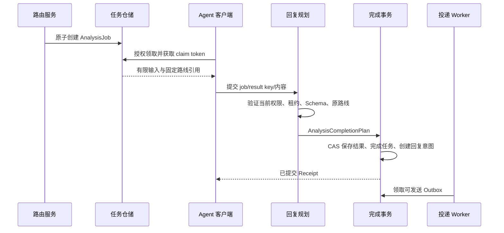

# 跨模块对接契约

P1 已落实 ContentStore、SourceCheckpoints、原子来源提交和配置/存储版本契约；下文未标注实现的通用端口仍为目标设计。详见[P1 实现](p1-storage.md)。

本契约定义 v0.4 模块之间的数据、调用、事务与失败语义。所有新端口为目标设计；现有 HTTP 链路的具体行为仍以运行说明为准。跨模块操作通过有类型的应用端口实现，不能通过共享数据库对象任意修改其他模块状态。

## 公共类型与身份

| 类型 | 必备语义 |
|---|---|
| WorkspaceId / ConnectionId / EventId 等 | Rust newtype 防止 ID 混用；所有仓储查询显式传工作区 |
| RevisionRef | 稳定对象 ID、工作区、不可变 revision 和内容摘要 |
| ExecutionAuthority | 原始主体、实际执行者、客户端、授权/委托引用、允许范围、授权版本和到期时间 |
| OperationContext | 请求/因果 ID、运行时 deadline、取消 token、连接范围；本身不等于授权 |
| LeaseToken | 工作区、对象 ID、holder、generation、到期时间；比较所有者、版本、有效期后 CAS |
| OperationKey | 工作区、命令用途、主体/客户端及调用方幂等键；记录规范化输入摘要 |
| Receipt | 明确已提交的操作 ID、状态、重复标志及后续任务引用；不推断外部执行已完成 |
| Failure | 安全错误码、阶段、是否已 dispatch、可证明的副作用状态及重试建议 |

authority 不存原始 access token；后台重查 Grant/Delegation。service principal 只获完成当前任务需要的权限。上游 actor、内容字段和模型结果不能覆盖内部身份。持久化使用 UTC 时间，进程内使用 Instant 控制时限，租约由存储时钟裁决。

端口返回 `PortFuture<'a,T>`，保持 `Send + Sync` 和对象安全。应用层负责鉴权/编排，仓储仍验证租户与 CAS 约束。协议 DTO、持久化 DTO 和领域模型分开，版本变化显式迁移。

## 写入所有权

| 数据 | 领域所有者 | 允许的跨模块提交端口 |
|---|---|---|
| 配置/活动指针/Profile 发布引用 | 配置与能力 | PublicationCommitter |
| 事件、消息映射、返回上下文、初始路由任务 | 事件与会话 | IngressCommitter |
| 路由状态、DispatchRun、投递及分析任务 | 路由、投递、Agent | RoutePlanCommitter |
| 分析结果、完成状态、回复意图/Outbox | Agent、会话、投递 | AnalysisCommitter |
| 调用预留、审批消费、执行 attempt | 调用、权限 | InvocationStore 的 reserve/start 事务 |
| 投递 attempt、结果、目标消息映射 | 投递与会话 | DeliveryOutbox 的 start/finish 扩展事务 |
| 审计意图 | 审计 | 随上述事务写入 AuditRecord/AuditOutbox |

计划对象由服务协调构建，事务实现验证引用、工作区、版本、租约与唯一键，不能仅信任“调用方已经检查”。数据库实现可在同一事务操作这些表，但领域状态转换规则仍由所属模块定义。外部请求/审批等待/模型推理不进入数据库事务。

## 接收与游标推进

1. 协议入口限制载荷并验证认证/签名、允许来源与来源租约。
2. Decoder 生成规范输入；IngressService 解析消息/内容、固定来源与 route_set_revision。
3. IngressCommitter 原子写入事件、必要消息与 ReplyRoute、唯一 RoutingTask；同库来源游标可在本事务 CAS 推进。
4. 返回 AcceptanceReceipt 后才能确认上游。游标无法同库原子提交时，先事件落盘、再游标推进、最后确认；重读以原生 ID 去重。

重复接收返回原记录。源 ID 重用但内容不同默认保留原事件，记录冲突诊断并按来源协议决定拒绝/标为修订；不能覆盖历史或重新触发自动路由。入口失败未确认时，来源必须按同一键重试。

## 路由与分支提交

RoutingTaskStore 按 due_at、配额与公平性领取，带已固定规则版本。Planner 读取不可变事件，执行受限条件/投影和目标授权，形成固定 DispatchPlan。

RoutePlanCommitter 在一个事务中：验证当前任务租约 → 保存 DispatchRun 和目标快照 → 创建逐目标 Delivery/AnalysisJob → 完成 RoutingTask → 记录审计。空计划也提交。若任何分支无效，整批不落库，任务进入可解释的 Blocked/RetryWait；它不得永久占据就绪扫描窗口。

发布新规则只影响之后固定到该规则集的接收任务。人工重放另建 run_id，明确选旧版本或新版本；自动任务和已提交计划不因配置变化被重新生成。投递失败只处理该目标，禁止重跑整张计划以重发其他成功目标。

## 工具调用

```text
协议请求
  → 认证 → Profile 可见范围 → 当前权限 → 输入 Schema
  → 预留 Invocation（唯一键与参数摘要）
  → 可选策略审批 → CAS 启动 + Started 审计
  → 取用受限凭据 → Executor / Runner
  → 保存实际结果与内容引用 → 输出投影/协议响应
```

副作用前若无法预留或审计，则不执行。副作用后，输出 Schema 错误/完成记录失败必须保留 dispatched/outcome 信息，不能把外层错误解释为“可以重试整个调用”。节点重复交付按 Invocation ID 查账本；写调用未知时阻止自动重跑。审批消费与 Invocation start 同事务，绑定操作和参数摘要。

## Agent 分析与原路回复



结果提交先查幂等记录：已完成且内容一致时，在验证当前读取权限后返回原 Receipt；内容不同 Conflict。新提交需当前有效租约、合法 result_version 与当前授权。结果与回复 Outbox/待审意图同事务；待审意图本身不可被投递 worker 领取。

Agent 通知/领取不等于完成，分析完成不等于回复送达。结果中只能包含允许的内容和路线引用；实际会话、收件人、线程与凭据从服务端绑定解析。交互式 messages.reply 也通过同一个 ReplyPlanner，但使用独立幂等命令；默认一次回复不代表任意重复回复都获授权。

## 投递与外部副作用

投递 worker 独立调度，获取具体 destination_revision 和原授权上下文。发送前重查授权、读取正确版本配置和秘密，原子记录 attempt/Sending；外部 I/O 在事务外。结束提交使用 lease generation CAS，并保存平台回执、MessageLink 与审计意图。

只确认“未发送”或“可安全按同一键重放”时自动重试。进入 Sending 后失联、超时或保存结果失败进入 OutcomeUnknown，保留核查证据。当前 SQLite 实现对过期 Sending 统一保守核查，未来适配器证明幂等后才可扩大自动恢复范围。

取消是请求：未开始的任务可 Cancelled；已开始请求协作停止，最终记录真实结果。权限撤销阻止后续检查通过，本地授权 epoch 可在事务中再校验；外部授权服务的撤销传播存在缓存窗口，应配置有界 TTL/失效通知，不能宣称已经发出的外部动作可即时撤回。

## 幂等键与复用

| 操作 | 唯一范围 | 重复输入行为 |
|---|---|---|
| 来源接收 | workspace + connection + partition + source_event_id | 返回原事件，不重建自动任务 |
| 自动路由 | workspace + event_id + automatic | 仅一次固定计划 |
| 人工重放 | workspace + replay_command_key | 同一命令返回同一新 run_id；异参拒绝 |
| 计划目标 | workspace + run_id + rule_revision + target_key + branch_index | 同一逻辑目标仅一份任务 |
| 工具调用 | workspace + actor/client + capability_revision + invocation_key | 同参重查，异参拒绝 |
| 分析完成 | workspace + job_id + result_version | 同内容返回原结果及回复 ID，异内容拒绝 |
| 交互式回复 | workspace + actor/client + reply_key | 固定 route/content 摘要，异参拒绝 |
| 外部投递重试 | workspace + delivery_id | 复用内容/目标/供应商幂等键，新建 attempt |

幂等记录有保留窗口，清理不能短于承诺支持的源重放期。跨主体键复用不会泄露其他人的结果。人工改变消息内容/收件人必须走新的授权操作，不能当作原任务重试。

## 故障与恢复责任

| 故障点 | 已提交事实 | 恢复者及行为 |
|---|---|---|
| 接收提交前崩溃 | 无接收成功 | 来源使用原键重试 |
| 接收成功、尚未路由 | Event + RoutingTask | 路由 worker 领取 |
| 计划中部分目标写入失败 | 事务整体回滚 | RoutingTask 退避/阻塞，不做半计划发送 |
| 分析结果提交后回包丢失 | Result + ReplyIntent | Agent 用同结果键重查，不再建回复 |
| 发送成功、finish 失败 | Sending/可能外部已完成 | 核查服务，拒绝无证据自动重发 |
| 旧 worker 在租约后返回 | 当前 generation 已变化 | 拒绝改权威状态，可留晚到证据 |
| 审计导出失败 | 本地 AuditOutbox | 审计导出 worker 按记录 ID 重试 |
| 新配置节点激活失败 | 新 Release 已发布 | 激活状态标 Degraded，按替换策略保留旧实例或停用 |

## 调度与模块装配

独立池包括来源运行、路由规划、消息投递、工具执行、Agent 通知、审计导出。每个池有并发/队列上限与停止流程，数据库 admission 和每目标预算进一步限制。Worker 扫描间隔不是处理延迟保证，readiness、积压数量和最老任务年龄共同反映进度。

先保留单 crate：`domain/<module>` 保存模型，`application/ports` 保存外部依赖，`application/services` 保存用例，`interfaces` 保存协议，`infrastructure` 保存实现。装配入口可按用途分组，避免所有场景必须构造一个含无用占位依赖的巨型 BackendModules。共享身份/策略、事务实现和 RuntimeRegistry，不能形成互相调用的服务环。
