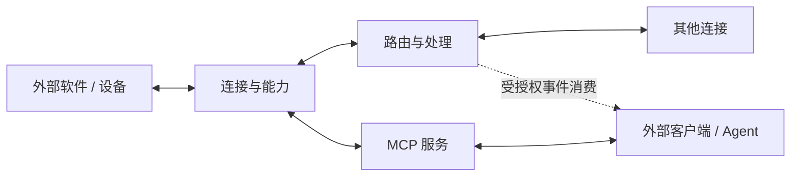

# 连接、路由与 MCP 网关：架构收敛

2026-10-28。本文件明确产品方向与迁移原则；目标不等于当前已经实现。历史设计中与本文件冲突的目标，以此文件为准；运行行为以代码和实际部署为准。

## 产品边界

Synquay 连接软件与设备，将其消息、事件、操作与状态统一管理；提供受控的消息路由与执行，并通过 MCP 向外部客户端开放选定能力。外部客户端可以是 Agent，也可以是其他程序。

Synquay 不内置 LLM 推理，不负责创建、调度或唤醒 Agent，不接管 Agent 的模型、提示词策略、推理循环和生命周期。MCP prompts 是可发布的协议内容，不等于内置推理。外部 HTTP 接收端或 Worker 可以是 Agent，但 Synquay 只以普通连接或客户端对待它。

虚线描述未来可选的事件消费契约，不代表现有产品提供通用推送，或某个 MCP 客户端能被自动唤醒。

## 责任划分

| 模块 | 应承担的职责 | 不承担的职责 |
| --- | --- | --- |
| 连接与能力 | 接收事件、发送消息、执行平台操作、读取和更新设备状态；公开参数与协议限制 | 选择模型或决定外部 Agent 如何推理 |
| 路由与处理 | 按来源/会话和条件匹配，有限转换、转发、调用已授权能力及支持的回复 | 通用 AI 编排、训练、自动推理或无限制脚本执行 |
| MCP 服务 | 将选定工具、资源、提示词等协议能力发布给有权客户端 | 假定客户端在线、支持通知或接到通知就会执行 |
| 交付与存储 | 持久化、去重、背压、重试、结果未知的核查、审计与观测 | 将提交成功当成外部业务或设备执行成功 |
| 认证与权限 | 工作区、主体、连接、会话和操作的授权，执行前重新检查 | 将模型输出中的目标和操作当作授权 |
| 外部系统 | 决定是否运行 Agent 或分类器、消费哪些事件及如何处理 | 无权绕过 Synquay 和上游平台的权限边界 |

## 与现有实现的对应

- Webhook、HTTP Client、MQTT Client、QQ Bot、通用路由、指令映射、能力调用、MCP 服务、交付、认证与审计属于核心。群管理仅是目标能力，需各平台提供相应事件和权限，当前不能视为已实现。
- Agent 专用路由处理器与收件箱已移除；外部 HTTP 服务使用普通 HTTP Client 连接和转发路由。旧配置和旧 Agent 路由不再兼容，需要重新配置。
- 旧版本数据库中的历史 Agent 表不会自动删除；移除功能不会触发历史数据清理。
- MQTT 资源状态当前由状态查询工具提供；原生 MCP resource 订阅及通用事件推送不应当作已交付能力。

## 典型流程

1. **Agent 操作设备**：设备连接注册工具和状态 → 管理员选择 MCP 服务开放的内容 → 外部 Agent 连接并调用 → Synquay 验权、执行并报告设备确认或未知结果。
2. **消息直接转发**：聊天连接接收消息 → 路由匹配与转换 → 目标连接发送 → 记录投递结果。整个过程不要求 MCP 客户端或模型在线。
3. **外部服务处理消息**：路由转发到普通 HTTP 接收端或其他连接 → 外部服务独立运行并分析 → 如需结果回传，使用已授权的入口和路由。当前通用回调尚不保证自动、安全地关联任意 QQ 原会话。
4. **群管理**：连接适配器声明实际可用的群事件、撤回或移除成员等能力 → 策略按群选择确定性规则及允许的动作 → 经权限检查后执行。复杂分类可交给外部服务；平台事件覆盖及机器人权限先核实。

外部服务接收消息时须遵守相应数据访问授权和保留策略；平台返回成功、Broker 接收和设备最终状态是不同结果，均应分别表达。

## 后续原则

1. 未来若需通用事件消费，应先明确范围授权、确认、重放、保留策略和客户端兼容性；MCP 通知不保证自动唤醒。
2. 保留通用事件存储、Outbox、租约、去重、审计和有界队列，不引入 Agent 专属任务模型。
3. 优先完善连接能力、通用路由、MCP 发布和权限；模型与外部服务运行由使用者自行选择。
